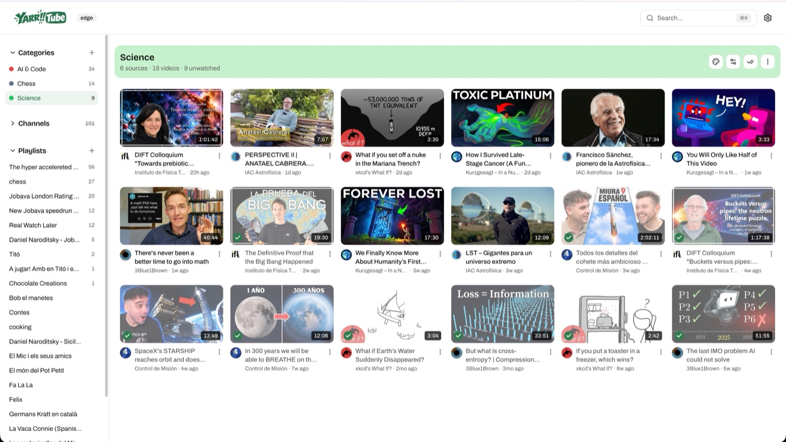
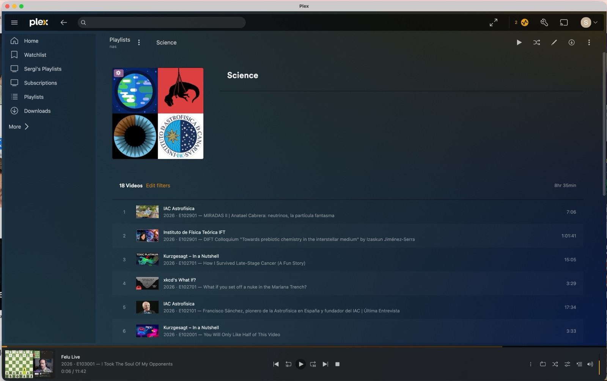

# Categories

A category is a topic you define, like "Science" or "Kids", that groups
channels and playlists. You can then watch by topic instead of by source:
one feed of everything new in "Kids", whichever channel it came from. A
channel or playlist can be in several categories.

  

## Create one

- Press **+** next to **Categories** in the sidebar, and pick a name, a color
  and its channels and playlists, all in one dialog.
- Change any of them later with **Edit settings**, or add a source from the
  **Categories** field when adding or editing a channel or playlist.
- New videos from those sources join the category on their own.

## What you get

- **A category page** with every video of its sources in one grid, playable
  as a single queue.
- **"More about \<category\>" rows on Home** for the categories with the
  most unwatched videos.
- **Colored chips** on video cards and **unwatched counts** in the sidebar.
- **Mark all watched** for the whole category at once.

## Fix a video by hand

Every video's **⋮** menu has **Edit categories…**: every category as a chip,
filled when the video is in it. Click a chip to add the video to that
category or take it out.

- A chip with a lock, marked **From \<channel or playlist\>**, comes from the
  video's source: change the source's categories instead.
- A chip marked **AI** was decided by the AI (see below). Clicking it replaces
  the AI's answer with yours.
- What you set by hand is never changed by the AI, nor by any **Re-run AI**
  or **Clear AI categories**, even when you set it while the AI is still
  answering for that video.

## Let AI fill them

With [AI](AI.md) on, a category can also gather videos from sources outside
it:

1. In **Settings → AI**, turn on categorization (summaries too: a video is
   judged from its summary).
2. Give the category an **AI prompt** in its **Edit settings**, describing the
   videos it should hold.
3. Turn on categorization for the channels and playlists whose videos should
   be judged.

Once a video of those sources has a summary, the AI asks once per category
with a prompt whether it belongs, and adds it to every category it fits. It
never removes a category a video gets from its source.

This happens on the video's next sync after its summary, at the latest its
source's next reconcile pass (every 3 hours by default), so a new video
shows its AI categories some time after it appears.

To ask the AI again, deleting its answers (not yours) so the categories it
gave go at once:

- **One video**: **Re-run AI** in its **Edit categories…** dialog. With its
  source's categorization off it reads **Clear AI categories**.
- **A channel or playlist**: **Re-run AI categorization** in its page's **⋮**
  menu. With categorization off, for that source or in **Settings → AI**, it
  reads **Clear AI categories**: the AI categories go and nothing is asked
  again.
- **A category**, e.g. after editing its prompt: **Re-evaluate N videos** in
  its **Edit settings**, below the AI prompt. Save the prompt first: the
  button waits for it, since the AI asks with the saved prompt.

The videos are synced straight away, so the AI asks again within minutes when
categorization is on.

Good to know:

- Otherwise each answer is final: editing a category's prompt, turning a
  source's categorization off or turning AI off doesn't re-judge anything or
  remove the categories the AI gave.
- A video the AI couldn't judge is tried again after you change the model,
  the categorization prompt, the Ollama URL, or that category's prompt.
- Judging takes a while (10 s to 100 s per video and category on a small
  machine) and runs in the background: look for _Categorizing …_ in the
  Tasks page (**AI** tab).

## In Plex

Each category becomes a **smart playlist** in Plex: its unwatched episodes,
newest first, across all its channels and playlists.

It needs the Plex integration working: a TV Shows library and the scan
trigger, steps 1 and 2 of the [Plex guide](PLEX.md). Nothing else to set up.

  

Good to know:

- Playlists are visible only to the Plex user whose token yarrtube uses
  (`YARRTUBE_PLEX_TOKEN`). Managed and shared users, like a kid's profile,
  don't get them.
- A category with episodes in several Plex libraries gets one playlist per
  library, e.g. `Science · Subscriptions` and `Science · Kids TV`.
- A playlist shows up within 15 minutes after Plex imports its first episode, and
  follows renames and deletes of its category. A playlist you delete in Plex
  comes back; delete the category instead.
- yarrtube builds the playlists from Plex labels named after your
  categories. It owns the labels of its episodes, so labels you add to them by
  hand are removed. If you restrict shared users by label, don't use a
  category name as a restriction label.
- No playlist? Look for _Syncing Plex category labels_ in the Tasks page
  (**Other** tab) and for `failed to reach Plex` in the log.

## Turning them off

Don't need categories? Turn off **Enable categories** in **Preferences**: all
category UI is hidden, and your categories are kept for when you turn it back
on.
