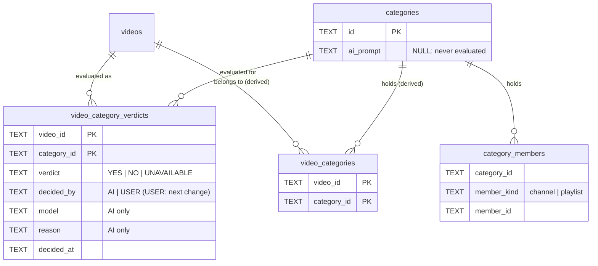
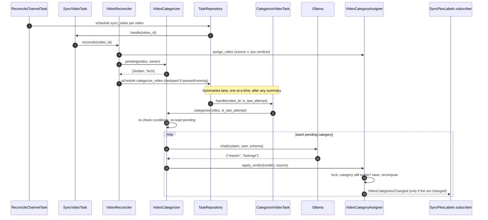
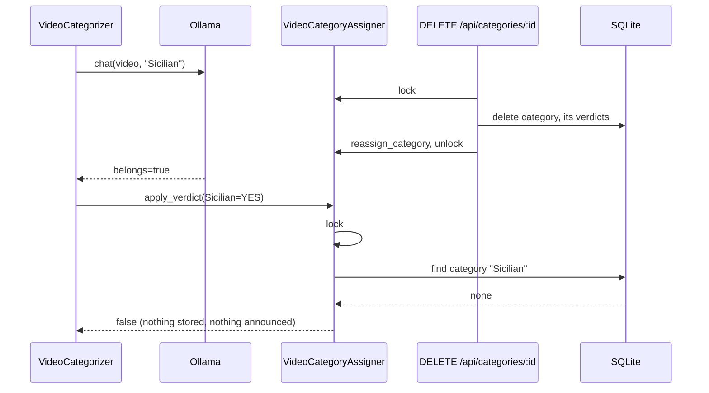

# Design

Product flow and the pair lifecycle: see `proposal.md`. Behaviour: see
`specs/video-categorization` and `specs/video-categories`.

## Diagrams

### Data model

`video_categories` stays the materialized result the UI, feeds and Plex read.
It is always `source categories ∪ yes verdicts`, recomputed by
`VideoCategoryAssigner`, so no `origin` column is needed: a pair holds one
verdict, and the next change's user verdicts replace the AI's in that row.



### From reconcile to Plex



### Category deleted during a call



## Files

**Created**
- `migrations/0025_video_category_verdicts.sql`: the verdicts table.
- `src/domain/video_category/video_category_verdict.rs`: `VideoCategoryVerdict`, `Verdict`, `VerdictAuthor`; one pair's verdict.
- `src/domain/video_category/pending_categories.rs`: pure rule for which categories are pending.
- `src/domain/video_category/categorization_question.rs`: builds the user message and the `LlmChat` for one pair; parses the answer.
- `src/domain/services/video_categorizer.rs`: `VideoCategorizer`, mirrors `VideoSummarizer`.
- `src/application/tasks/categorize_video_task.rs`: `CategorizeVideoTask`, the `categorize_video` handler.
- `src/infrastructure/repositories/sqlite_video_category_verdict_repository.rs`: port + SQLite adapter.

**Changed**
- `prompts/categorization/README.md`: v2 shipped.
- `src/domain/preferences/categorization_prompt.rs`: `SHIPPED` includes `v2.md`.
- `src/domain/preferences/preferences.rs`: `changes_categorization`.
- `src/domain/llm_server/llm_chat.rs`: `format` (response JSON schema); summarizer passes `None`.
- `src/infrastructure/repositories/ollama_llm_server_repository.rs`: sends `format` when set.
- `src/domain/video_category/mod.rs`: exports.
- `src/domain/video/{video,video_owner,video_sync_plan,video_sync_step}.rs`: `is_categorizable`, owner's `categorization_enabled` and `source_name`, `Categorize` step.
- `src/domain/task/task.rs`: `Task::CategorizeVideo`, type `categorize_video`, Summaries lane, `video:<id>` key.
- `src/domain/services/video_owner_finder.rs`: fills the new owner fields.
- `src/domain/services/video_reconciler.rs`: `categorization_wanted`, passes it to the plan.
- `src/domain/services/video_category_assigner.rs`: union with yes verdicts everywhere, `apply_verdict`.
- `src/domain/services/category_deleter.rs`: deletes the category's verdicts under the lock.
- `src/domain/services/category_updater.rs`: prompt changed → `delete_unavailable_for_category`.
- `src/domain/services/preferences_updater.rs`: `changes_categorization` → `delete_unavailable`.
- `src/domain/services/{channel,playlist}_video_reconciler.rs`: delete a removed video's verdicts.
- `src/domain/services/{channel,playlist}_deleter.rs`: delete the verdicts of every video of the deleted source.
- `src/domain/services/task_view_searcher.rs`: resolves `categorize_video` to its video.
- `src/domain/services/mod.rs`, `src/application/tasks/mod.rs`, `src/serve.rs`, `src/infrastructure/infrastructure_container.rs`, `src/infrastructure/repositories/mod.rs`: wiring, task type list.
- `web/src/lib/tasks.ts` (+ `tasks.test.ts`): label "Categorizing …", AI family.
- `doc/AI.md`, `doc/CATEGORIES.md`: how and when videos are categorized.
- `src/domain/video/video_chapter.rs`: `VideoChapter::listed` / `clock`, moved from `src/domain/video_summary/summary_input.rs` (which now uses them) so summaries and categorization share them.
- `src/domain/video_category/video_categories.rs`: `without` removed (the old uncategorized-source regime).
- `src/domain/services/video_summarizer.rs`: passes `format: None`.
- `src/infrastructure/shared/sqlite_migrations.rs`: registers migration 0025.
- `web/src/test/helpers.tsx`: shipped prompt `v2.md`.
- Test-only wiring of the new constructors: `src/domain/services/internal_video_reconciler.rs`, `src/application/subscribers/reconcile_on_{channel,playlist}_created.rs`, `src/application/tasks/summarize_video_task.rs`; `src/application/http/tasks/mod.rs` (task view test).

## Types & Signatures

```sql
-- migrations/0025_video_category_verdicts.sql
CREATE TABLE IF NOT EXISTS video_category_verdicts (
    video_id    TEXT NOT NULL,
    category_id TEXT NOT NULL,
    verdict     TEXT NOT NULL,      -- YES | NO | UNAVAILABLE
    decided_by  TEXT NOT NULL,      -- AI | USER
    model       TEXT,
    reason      TEXT,
    decided_at  TEXT NOT NULL,
    PRIMARY KEY (video_id, category_id)
);
CREATE INDEX IF NOT EXISTS idx_video_category_verdicts_category
    ON video_category_verdicts (category_id);
```

```rust
// domain/video_category/video_category_verdict.rs
pub enum Verdict { Yes, No, Unavailable }            // as_str / parse: "YES" …
pub enum VerdictAuthor { Ai, User }                  // as_str / parse: "AI" | "USER"
pub struct VideoCategoryVerdict {
    pub video_id: VideoRecordId,
    pub category_id: CategoryId,
    pub verdict: Verdict,
    pub decided_by: VerdictAuthor,
    pub model: Option<String>,
    pub reason: Option<String>,
    pub decided_at: DateTime<Utc>,
}
impl VideoCategoryVerdict {
    pub fn answered(video_id: VideoRecordId, category_id: CategoryId, answer: CategorizationAnswer,
                    model: &str, now: DateTime<Utc>) -> Self;
    pub fn unavailable(video_id: VideoRecordId, category_id: CategoryId, model: &str,
                       now: DateTime<Utc>) -> Self;
    pub fn is_yes(&self) -> bool;
}

// domain/video_category/pending_categories.rs
/// Categories with an AI prompt, not holding `source`, without a verdict in `verdicts`.
pub fn pending_categories(categories: Vec<Category>, source: &CategoryMember,
                          verdicts: &[VideoCategoryVerdict]) -> Vec<Category>;

// domain/video_category/categorization_question.rs
pub const CONTEXT_LENGTH: u32 = 4096;
pub const MAX_OUTPUT_TOKENS: u32 = 3072;
pub struct CategorizationQuestion { /* title, source_name, minutes, chapters, summary, category */ }
impl CategorizationQuestion {
    pub fn new(video: &Video, source_name: &str, summary: &SummaryText, category: &Category) -> Self;
    pub fn user_message(&self) -> String;
    pub fn chat(&self, settings: &CategorizationSettings, thinking: bool) -> LlmChat;
}
pub struct CategorizationAnswer { pub belongs: bool, pub reason: String }
impl CategorizationAnswer {
    /// After the last `</think>`, the JSON object with a boolean `belongs`; `None` otherwise.
    pub fn parse(content: &str) -> Option<Self>;
}

// domain/llm_server/llm_chat.rs
pub struct LlmChat { /* … */ pub format: Option<serde_json::Value> }

// domain/video
impl Video { /// Summary Generated.
             pub fn is_categorizable(&self) -> bool; }
pub struct VideoOwner { /* … */ pub categorization_enabled: bool, pub source_name: String }
pub enum VideoSyncStep { /* … */ Categorize }
impl VideoSyncPlan {
    pub fn for_video(video: &Video, summaries_wanted: bool, categorization_wanted: bool,
                     now: DateTime<Utc>) -> Self;
}

// domain/task
pub enum Task { /* … */ CategorizeVideo { video_id: String } }
impl Task { pub fn decode_categorize_video_payload(payload: &str) -> Result<String, TaskError>; }
// lane_for("categorize_video") == TaskLane::Summaries; exclusivity_key → "video:<id>"

// domain/preferences
impl Preferences {
    /// Ollama URL, categorization model or prompt differ.
    pub fn changes_categorization(&self, other: &Self) -> bool;
}

// domain/services/video_categorizer.rs
pub trait VideoCategorizerApi: Send + Sync {
    /// Categories pending for `video` now (see `video-categorization`).
    fn pending(&self, video: &Video, owner: &VideoOwner) -> anyhow::Result<Vec<Category>>;
    /// Asks about each pending category; Err when any call was rejected, after trying all.
    fn categorize(&self, video: &Video, is_last_attempt: bool) -> anyhow::Result<()>;
}
pub struct VideoCategorizer {
    preferences_repository: Arc<dyn PreferencesRepository>,
    video_owner_finder: Arc<VideoOwnerFinder>,
    category_repository: Arc<dyn CategoryRepository>,
    video_category_verdict_repository: Arc<dyn VideoCategoryVerdictRepository>,
    video_summary_repository: Arc<dyn VideoSummaryRepository>,
    llm_server_repository: Arc<dyn LlmServerRepository>,
    video_category_assigner: VideoCategoryAssigner,
    clock: Arc<dyn Clock>,
}

// domain/services/video_category_assigner.rs
pub trait VideoCategoryAssignerApi: Send + Sync {
    /* lock, reassign_category, announce_renamed unchanged */
    /// Sets the record to its source's categories ∪ its yes verdicts (no early return).
    fn assign_video(&self, video_id: &VideoRecordId, source: &CategoryMember) -> anyhow::Result<()>;
    /// Under the lock: false, storing nothing, when the video or the category is
    /// gone; else saves the verdict and runs `assign_video`'s recompute. A video
    /// removed meanwhile leaves nothing stored either (`forget_if_removed`).
    fn apply_verdict(&self, verdict: &VideoCategoryVerdict, source: &CategoryMember) -> anyhow::Result<bool>;
    /// `apply_verdict`, also storing nothing when `still_current`, asked under
    /// the lock, says the verdict is outdated. `apply_verdict` delegates here.
    fn apply_verdict_if(&self, verdict: &VideoCategoryVerdict, source: &CategoryMember,
                        still_current: &dyn Fn() -> anyhow::Result<bool>) -> anyhow::Result<bool>;
}
// VideoCategoryAssigner gains video_category_verdict_repository (and reads
// video_repository to check the video still exists)
// ChannelDeleter, PlaylistDeleter gain video_category_verdict_repository
// PreferencesUpdater gains video_category_verdict_repository and category_lock: Arc<CategoryLock>
// VideoCategorizer's job keeps the Preferences it started with

// infrastructure/repositories/sqlite_video_category_verdict_repository.rs
pub trait VideoCategoryVerdictRepository: Send + Sync {
    fn find_many(&self, video_ids: &[VideoRecordId]) -> anyhow::Result<Vec<VideoCategoryVerdict>>;
    /// Replaces the pair's verdict.
    fn save(&self, verdict: &VideoCategoryVerdict) -> anyhow::Result<()>;
    fn delete_for_video(&self, video_id: &VideoRecordId) -> anyhow::Result<()>;
    fn delete_for_category(&self, category_id: &CategoryId) -> anyhow::Result<()>;
    fn delete_unavailable(&self) -> anyhow::Result<()>;
    fn delete_unavailable_for_category(&self, category_id: &CategoryId) -> anyhow::Result<()>;
}
pub struct SqliteVideoCategoryVerdictRepository { db: Database }
pub struct FakeVideoCategoryVerdictRepository;   // #[cfg(test)] only if a test needs a failing one
```

```ts
// web/src/lib/tasks.ts
case 'categorize_video': return `Categorizing ${videoInContainer(payload)}`
// family 'ai', sort group 'ai'
```

## Call Stack

**Schedule** (every reconcile pass)
1. `SyncVideoTask::handle(payload)` → `VideoReconciler::reconcile(&video_id)`
2. → `VideoCategoryAssigner::assign_video(&video.id, &owner.source)` → `CategoryRepository::list()`, `VideoCategoryVerdictRepository::find_many(&[id])`, `VideoCategoriesRepository::find_many/save_many`, `EventPublisher::publish` if changed
3. → `VideoReconciler::categorization_wanted(&video, &owner)`: `owner.categorization_enabled && preferences.categorization_available() && video.is_categorizable()` then `VideoCategorizer::pending(&video, &owner)` → `CategoryRepository::list()`, `VerdictRepository::find_many(&[id])`, `pending_categories(categories, &owner.source, &verdicts)` → `!is_empty()`
4. → `VideoSyncPlan::for_video(&video, summaries_wanted, categorization_wanted, now)` → `TaskRepository::schedule(&Task::CategorizeVideo { video_id }, now)` (deduped)

By design nothing syncs a video when its summary is generated: a newly summarized video is categorized from its next sync, at the latest its source's next reconcile pass.

**Run** (`summaries` lane)
1. `CategorizeVideoTask::handle(payload, is_last_attempt)` → `VideoRepository::find(&id)` → `VideoCategorizer::categorize(&video, is_last_attempt)`
2. `prepare(&video)`: `PreferencesRepository::find()` (available?), `video.is_categorizable()`, `VideoOwnerFinder::find(&video)` (`categorization_enabled`?), `VideoSummaryRepository::find(&id)`, `LlmServerRepository::find(&url)` → `server.model(name)` (thinking), `pending(&video, &owner)`; a skip logs and returns `Ok(())`
3. per category: `CategorizationQuestion::new(&video, &owner.source_name, &summary.text, &category).chat(&settings, thinking)` → `LlmServerRepository::chat(&url, &chat)` → reply checks (refusal, `stopped_at_limit`) → `CategorizationAnswer::parse(&reply.content)` → `VideoCategoryVerdict::answered(..)` → `VideoCategoryAssigner::apply_verdict(&verdict, &owner.source)`
4. after the loop, rejected categories: last attempt → `apply_verdict_if(&VideoCategoryVerdict::unavailable(..), source, unchanged_since(job, category))` each, where `unchanged_since` (asked under the lock) is `!job.preferences.changes_categorization(&current)` and the category's current `ai_prompt` equals the job's; return `Err` → queue backoff. Server error (`chat` → `Err`) → warn, return `Ok(())`

**Category deleted**: `DELETE /api/categories/:id` → `CategoryDeleter::delete(&id)` → `assigner.lock()` → `CategoryRepository::delete(&id)`, `VerdictRepository::delete_for_category(&id)` → `reassign_category(..)`

**Settings**: `PUT /api/preferences` → `PreferencesUpdater::update(change)` → `stored.changes_categorization(&updated)` → `CategoryLock::lock()` → `VerdictRepository::delete_unavailable()`. `PATCH /api/categories/:id` with a different `ai_prompt` → `CategoryUpdater` → `assigner.lock()` → `VerdictRepository::delete_unavailable_for_category(&id)`. Both deletes run under the category lock, so a run giving up either sees the new settings or has its unavailable verdicts deleted after it.

**Video removed**: `{Channel,Playlist}VideoReconciler::remove_videos_not_in` → `VerdictRepository::delete_for_video(&video.id)` next to `VideoCategoriesRepository::delete`

**Source deleted**: `DELETE /api/channels/:handle` → `ChannelDeleter::delete_channel_videos(&id)` → per video `VerdictRepository::delete_for_video(&video_id)` next to `VideoCategoriesRepository::delete` (same in `PlaylistDeleter`)

**Video removed during its call**: `apply_verdict` → `assigner.lock()` → `VideoRepository::find_by_id(&verdict.video_id)` is `None` → return `false`, nothing stored. Removed between that check and the save (the removal paths take no category lock): after recompute, `forget_if_removed` finds the video gone and deletes its verdicts and `video_categories`, returning `false`. Cleanup is domain code everywhere; the schema has no foreign keys or cascades.

## Test Plan

**1. Behaviour**

`SyncVideoTask` (`sync_video_task.rs`)
1. `it_should_give_a_video_its_source_categories_plus_its_yes_verdicts`: source in "Chess", yes "Sicilian", no "Tech" → video in exactly Chess + Sicilian.
2. `it_should_give_a_video_of_an_uncategorized_source_its_yes_verdicts`: source in none, yes "Chess" → video in exactly Chess.
3. `it_should_schedule_a_categorization_for_a_summarized_video_with_pending_categories`: one `categorize_video` task.
4. `it_should_not_schedule_a_categorization_without_a_generated_summary`: Missing and Unavailable summaries.
5. `it_should_not_schedule_a_categorization_when_the_source_has_categorization_off`.
6. `it_should_not_schedule_a_categorization_when_ai_categorization_is_off`: AI, categories or categorization off.
7. `it_should_not_schedule_a_categorization_when_every_category_has_a_verdict`: yes, no and unavailable all count.
8. `it_should_not_count_a_category_given_by_the_source_or_without_a_prompt_as_pending`.
9. `it_should_not_schedule_a_second_categorization_while_one_is_pending`.

`CategorizeVideoTask` (`categorize_video_task.rs`)

10. `it_should_store_a_yes_verdict_and_add_the_category_to_the_video`: verdict with model + reason, video in category, one event.
11. `it_should_store_a_no_verdict_without_changing_the_video_categories`: no event.
12. `it_should_send_the_video_details_and_category_prompt_with_the_categorization_settings`: system = effective prompt, user message fields, temperature 0, context 4096, 3072 output tokens, schema, thinking from capabilities.
13. `it_should_read_the_answer_after_leaked_thinking`.
14. `it_should_only_ask_about_categories_pending_when_it_runs`: deleted before run → not asked; prompt added → asked.
15. `it_should_do_nothing_when_the_conditions_no_longer_hold`: source turned off before run → no chat.
16. `it_should_not_store_a_verdict_for_a_category_deleted_during_its_call`: `with_on_chat` hook deletes it → no verdict, no category, no event.
17. `it_should_not_store_a_verdict_for_a_video_removed_during_its_call`: `with_on_chat` hook deletes the video → no verdict row, no event.
18. `it_should_fail_after_trying_every_category_when_a_call_is_rejected`: unusable answer on one, others stored, `Err`.
19. `it_should_retry_only_the_categories_still_pending`.
20. `it_should_mark_rejected_categories_unavailable_on_the_last_attempt`: stopped at limit, refusal, unusable.
21. `it_should_complete_without_verdicts_when_ollama_is_unreachable`: also model not installed.
22. `it_should_log_each_verdict`.

HTTP `categories` (`http/categories/mod.rs`)

23. `it_should_delete_a_categorys_verdicts_with_it`.
24. `it_should_keep_yes_verdict_categories_when_a_source_leaves_a_category`.
25. `it_should_make_unavailable_verdicts_pending_when_a_category_prompt_changes`.
26. `it_should_keep_verdicts_when_a_category_prompt_is_edited_or_cleared`.

HTTP `preferences` (`http/preferences/mod.rs`)

27. `it_should_delete_unavailable_verdicts_when_categorization_settings_change`: model, prompt, Ollama URL; yes/no kept.
28. `it_should_keep_unavailable_verdicts_when_the_same_settings_are_saved`.

`ReconcileChannelTask` (`reconcile_channel_task.rs`)

29. `it_should_delete_a_removed_videos_verdicts`: video drops out of the channel's recent uploads → its verdicts are gone.

`ReconcilePlaylistTask` (`reconcile_playlist_task.rs`)

30. `it_should_delete_a_removed_playlist_videos_verdicts`.

`ChannelDeleter` (`http/channels/mod.rs`)

31. `it_should_delete_the_verdicts_of_a_deleted_channels_videos`.

`PlaylistDeleter` (`http/playlists/mod.rs`)

32. `it_should_delete_the_verdicts_of_a_deleted_playlists_videos`.

Web (`tasks.test.ts`)

33. `labels a categorize_video task and files it under AI`.

Added after the audit

34. `it_should_not_mark_a_category_unavailable_when_the_settings_changed_during_its_attempt` (`categorize_video_task.rs`): model or category prompt changed during the last attempt → no unavailable verdict.
35. `it_should_not_keep_a_verdict_for_a_video_removed_while_it_was_stored` (`categorize_video_task.rs`): video removed while its yes verdict is stored → no verdict, no categories.
36. `it_should_keep_unavailable_verdicts_when_a_category_prompt_is_saved_unchanged` (`http/categories/mod.rs`).
37. `it_should_list_a_categorize_video_task_with_video_and_channel_names` (`http/tasks/mod.rs`).

**Value objects**

`Verdict`, `VerdictAuthor` (`video_category_verdict.rs`): round trip every variant, reject an unknown value.
`CategorizationAnswer::parse` (`categorization_question.rs`): plain JSON, after the last leaked thinking, surrounded by prose; `None` without a JSON object, with the object only in the thinking, with invalid JSON, without `belongs`, with a non-boolean `belongs`.

**2. Infrastructure**

`SqliteVideoCategoryVerdictRepository`
1. `it_should_save_and_find_verdicts_of_several_videos`.
2. `it_should_replace_a_pairs_verdict`.
3. `it_should_delete_a_videos_verdicts`.
4. `it_should_delete_a_categorys_verdicts`.
5. `it_should_delete_only_unavailable_verdicts`.
6. `it_should_delete_the_unavailable_verdicts_of_one_category`.

`OllamaLlmServerRepository`

7. `it_should_send_the_response_schema_as_format`: present when set, absent when `None`.
