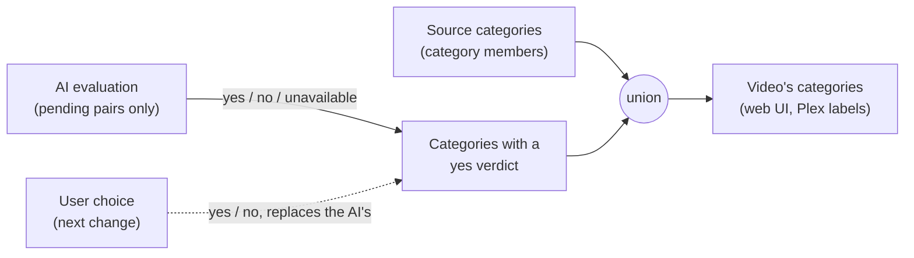
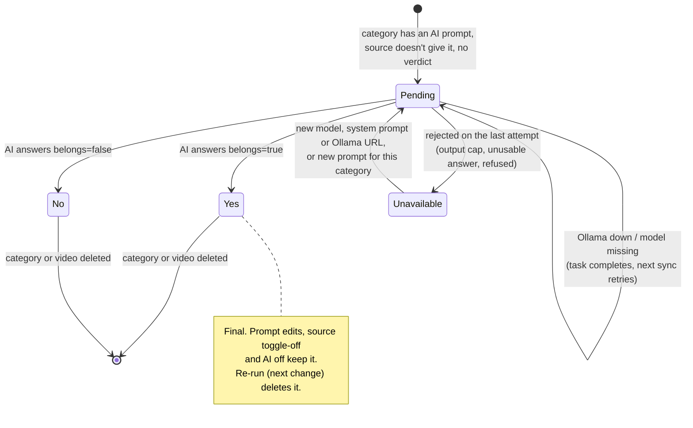
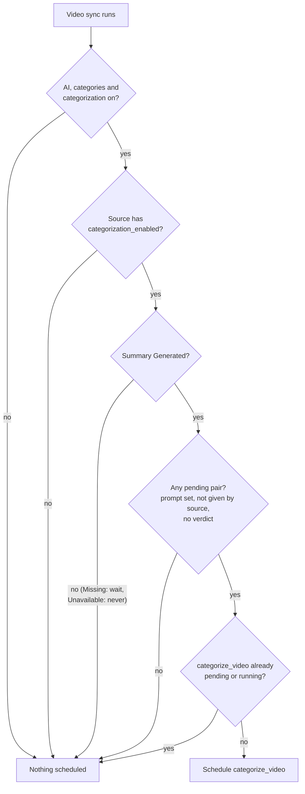

# Proposal

## Why

Sources can opt in to AI categorization and categories have AI prompts, but
nothing evaluates a video yet. A video should end up in the categories whose
description it fits, without re-asking the model on every reconcile pass: one
call takes about 10 s to 100 s on the NAS, so re-running is hours of work.

## What Changes

- Each (video, category) pair gets at most one **verdict**: yes, no or
  unavailable, decided by the AI (a later change adds user verdicts). A pair
  with a verdict is never evaluated again, whatever the verdict.
- A video's sync schedules a categorization when the AI, categories and
  categorization are on, its source has categorization enabled, its summary is
  Generated and at least one pair is **pending**: a category with an AI prompt
  that its source doesn't already give and that has no verdict for it.
- The categorization asks the model once per pending pair (system prompt,
  video details, category prompt) and stores each answer as it comes. The
  pending pairs are read when the task runs, so a category deleted in the
  meantime is not evaluated.
- **A video's categories become its source's categories plus every category
  with a yes verdict for it.** Today a source in a category gives exactly its
  categories; now the AI can add more.
- A pair the model can't answer after every retry (output cap hit, unusable
  answer, prompt refused) becomes unavailable. Saving new categorization
  settings, or a new prompt for that category, makes it pending again. A server
  problem (Ollama unreachable, model missing) leaves the pair pending.
- Turning a source's categorization off stops new evaluations; its videos keep
  the categories the AI gave them.
- Editing or clearing a category's prompt re-evaluates nothing; the AI
  categories already given stay.
- Deleting a category or a video deletes its verdicts.
- The shipped categorization prompt becomes `prompts/categorization/v2.md`.

### Life of a (video, category) pair

### Does a video's sync schedule a categorization?

The steady state, every category answered, costs two SQLite reads per video
per pass and no model call.

Out of scope, in the follow-up change `video-category-actions`: adding or
removing a video's categories by hand, re-running the AI for a video, source
or category, and clearing a source's AI categories.

## Capabilities

### New Capabilities
- `video-categorization`: when a video is evaluated against categories by the
  AI, how each pair's verdict is stored and reused, what the model is asked,
  and how failures and setting changes are handled.

### Modified Capabilities
- `video-categories`: a video's categories are its source's categories plus
  its yes verdicts, instead of exactly its source's when the source is in any;
  verdicts are deleted with their category or video.
- `source-categorization`: the setting now decides whether the source's
  videos are evaluated, instead of having no effect.
- `preferences`: the shipped categorization prompt becomes
  `prompts/categorization/v2.md`.

## Impact

- New SQLite table for verdicts (migration), no change to `video_categories`.
- Rust: a new categorization service and task (sharing the summaries lane, so
  one Ollama call runs at a time), `VideoSyncPlan` gains a step,
  `VideoCategoryAssigner` computes the union, `LlmChat` gains a response
  schema, preferences and category updates reset unavailable verdicts.
- Plex labels follow through the existing `video_categories_changed` event.
- No HTTP API change. The web UI only gains the label of the new task in the
  tasks view (AI family).
- Categorization only runs on videos with a summary, so a source needs
  summaries on too for its videos to be categorized.
