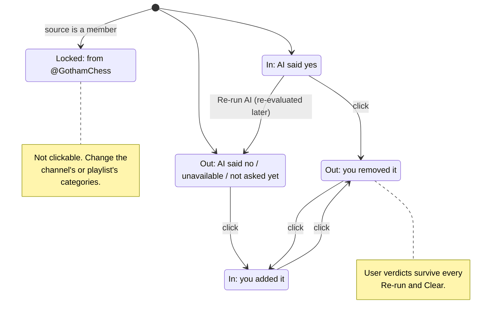
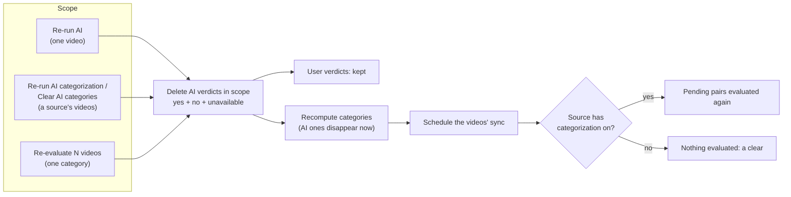

# Proposal

Builds on `categorize-videos-on-reconcile` (archive it first): verdicts per
(video, category), a video's categories = source categories ∪ yes verdicts.

## Why

The AI will get some videos wrong, and a category prompt edited later only
applies to new videos. Without a way to correct a video by hand or ask the AI
again, a wrong answer stays forever, since verdicts are final.

## What Changes

- **Edit categories (per video).** A video's "⋮" menu gets "Edit
  categories…": a dialog with every category as a chip. Clicking a chip stores
  a **user verdict** (`decided_by = user`) for that pair, replacing the AI's.
  The AI never evaluates or changes a pair the user decided. Chips for
  categories the video gets from its channel or playlist are locked; they
  change through the source's membership.
- **Re-run AI (per video, per source, per category).** Deletes the AI
  verdicts in that scope (yes, no and unavailable) and keeps user verdicts.
  The AI categories go away at once, and the affected videos are synced
  straight away so the pending pairs are evaluated again.
  - Video: a "Re-run AI" button in the Edit categories dialog.
  - Source: an item in the channel or playlist "⋮" menu. With categorization
    on it reads "Re-run AI categorization"; with it off nothing is
    re-evaluated, so it reads "Clear AI categories". Same action.
  - Category: a "Re-evaluate N videos" button in the category settings
    dialog, next to the prompt, with a confirmation naming N.
- Category responses gain `ai_verdict_count`, the N above.

Out of scope: a way back from a user verdict to "let the AI decide" (kept
lean on purpose, revisit after use), editing a video's categories in bulk.

### One chip, one click

### What each action removes

## Capabilities

### New Capabilities
- `video-category-editing`: the HTTP API to read a video's categories with
  where each comes from, set one by hand, and delete AI verdicts per video,
  source or category.

### Modified Capabilities
- `web-ui`: the Edit categories dialog, the source menu item, and the
  re-evaluate button in the category settings dialog.
- `category-crud`: category responses include `ai_verdict_count`.

## Impact

- Rust: new HTTP routes under `videos`, `channels`, `playlists`,
  `categories`; a service writing user verdicts and deleting AI verdicts;
  `VideoCategoryVerdictRepository` gains scoped deletes and a count. No
  migration (`decided_by` exists since the previous change).
- Web: `VideoCategoriesDialog`, `VideoActionsMenu`, `EntryActionsMenu`,
  `CategorySettingsDialog`, API client, types and fixtures.
- e2e: one spec for editing a video's categories by hand.
